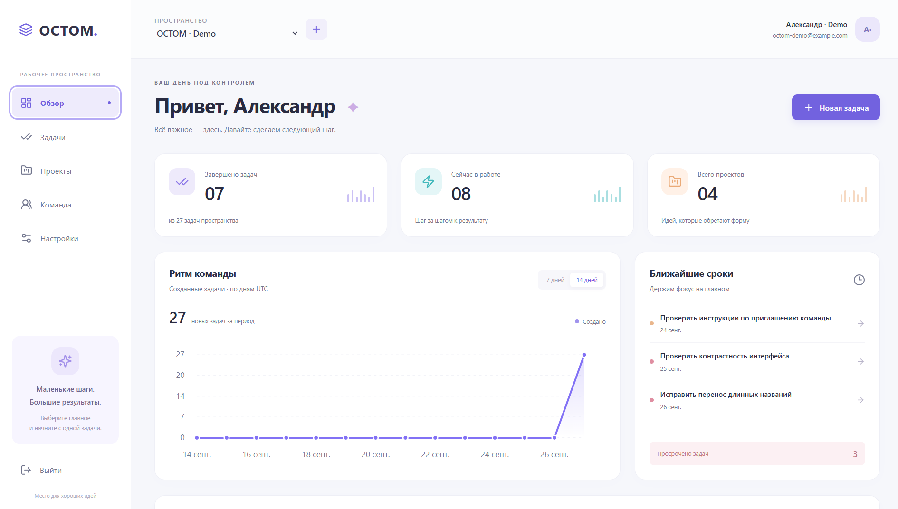

# Task Management · OCTOM

Приложение для управления задачами команды: рабочие пространства, проекты,
исполнители, сроки и роли доступа. Backend предоставляет асинхронный REST API,
а web-интерфейс позволяет работать с ним через браузер.

**Статус:** рабочий локальный MVP. Реализованы API, адаптивный frontend,
контейнерный запуск, миграции и автоматические проверки.



## Возможности

- Регистрация, вход, JWT access-токены и ротация refresh-токенов.
- Рабочие пространства с изоляцией данных и ролями Admin, Manager, Member, Viewer.
- Создание, изменение и удаление проектов и задач.
- Статусы задач: к выполнению, в работе, готово, отменено.
- Приоритеты: низкий, средний, высокий, срочный; сроки, исполнители и теги.
- Поиск, фильтры, сортировка и серверная пагинация.
- Сводка по пространству: завершённые задачи, задачи в работе, проекты и просрочки.
- График создания задач за 7 или 14 дней и список ближайших сроков.
- Управление участниками, их ролями и собственным профилем.
- Rate limiting через Redis, health endpoints, JSON-логи и метрики Prometheus.

### Роли

Роль назначается внутри конкретного пространства. Все участники могут читать
его проекты и задачи; ограничения на изменение проверяются на сервере.

| Роль    | Права на изменение                                                       |
| ------- | ------------------------------------------------------------------------ |
| Admin   | Пространство, участники и роли, проекты, теги и любые задачи             |
| Manager | Проекты, теги и любые задачи                                             |
| Member  | Создание задач; изменение и удаление задач, где он автор или исполнитель |
| Viewer  | Только просмотр; назначение исполнителем недоступно                      |

Последнего администратора нельзя удалить или понизить в роли. При удалении
участника или переводе в Viewer его назначения на задачи снимаются.

## Стек

| Часть проекта     | Технологии                                                         |
| ----------------- | ------------------------------------------------------------------ |
| Backend           | Python 3.12+, FastAPI, Uvicorn, Pydantic v2                        |
| Данные            | PostgreSQL 18, SQLAlchemy 2.0 AsyncIO, asyncpg, Alembic            |
| Безопасность      | Argon2id, JWT, Redis 8.2 для rate limiting                         |
| Frontend          | React 19, TypeScript strict, Vite, TanStack Query, Lucide, CSS/SVG |
| Инфраструктура    | Docker Compose, Nginx, uv, npm                                     |
| Проверки Python   | pytest, pytest-asyncio, HTTPX, coverage, Ruff, Black, mypy         |
| Проверки frontend | Vitest, Testing Library, ESLint, Prettier, TypeScript              |

Версии зависимостей закреплены в [uv.lock](uv.lock) и
[frontend/package-lock.json](frontend/package-lock.json).

## Быстрый запуск

Нужны запущенный Docker с Compose v2+ и Python 3.12+ для подготовки `.env`.
Node.js на хосте для контейнерного запуска не требуется.
Выполните из корня репозитория:

```sh
python scripts/bootstrap_env.py
docker compose up -d --build --wait
```

Скрипт создаёт `.env` из [.env.example](.env.example) и генерирует JWT-секрет.
Непустой существующий `.env` сохраняется. Если Python уже установлен в локальную
`.venv`, в PowerShell можно использовать
`.\.venv\Scripts\python.exe scripts/bootstrap_env.py`.

Compose запускает PostgreSQL, Redis, миграции, API и web. API стартует после
успешного применения миграций; frontend обращается к нему через Nginx на том же
origin.

| Сервис               | Адрес                                                             |
| -------------------- | ----------------------------------------------------------------- |
| Приложение           | [127.0.0.1:3000](http://127.0.0.1:3000)                           |
| Swagger UI           | [127.0.0.1:8000/docs](http://127.0.0.1:8000/docs)                 |
| OpenAPI              | [127.0.0.1:8000/openapi.json](http://127.0.0.1:8000/openapi.json) |
| Liveness / Readiness | `/health/live` и `/health/ready` на порту 8000                    |
| Метрики Prometheus   | [127.0.0.1:8000/metrics](http://127.0.0.1:8000/metrics)           |
| PostgreSQL           | `127.0.0.1:5433`                                                  |
| Redis                | `127.0.0.1:6380`                                                  |

В новом окружении зарегистрируйтесь, создайте пространство, затем проект и
первую задачу. Создатель пространства получает роль Admin. Для добавления
участника укажите email его уже зарегистрированного аккаунта.

В текущей локальной БД пространство **OCTOM · Demo** заполнено синтетическими
данными: 27 задач, 4 проекта, 6 тегов и 3 участника. Эти данные не включены в
миграции и не создаются автоматически при новом запуске на чистой БД.

### Управление контейнерами

```sh
docker compose ps
docker compose logs --tail=100 api
docker compose stop
docker compose up -d --wait
```

Основная PostgreSQL использует именованный volume. Обычная остановка контейнеров
сохраняет данные.

PgAdmin доступен как дополнительный профиль:

```sh
docker compose --profile tools up -d pgadmin
```

Адрес: [127.0.0.1:5050](http://127.0.0.1:5050). Локальные параметры входа
описаны в [compose.yaml](compose.yaml).

Если Docker CLI отсутствует в `PATH` на Windows, используйте полный путь к нему,
например для текущей установки Docker Desktop:

```powershell
& "$env:LOCALAPPDATA/Programs/DockerDesktop/resources/bin/docker.exe" compose up -d --build --wait
```

## Локальная разработка

Для frontend нужен Node.js 24 с npm. Примеры ниже рассчитаны на PowerShell;
активация `.venv` необязательна, поскольку Python-команды используют явные пути.

### Backend

Создайте окружение и установите зависимости из lock-файла:

```powershell
python -m venv .venv
.\.venv\Scripts\python.exe -m pip install uv==0.12.19
.\.venv\Scripts\uv.exe sync --frozen
.\.venv\Scripts\python.exe scripts/bootstrap_env.py
```

Если приложение уже работает в Docker, освободите порт API, остановив `web` и
`api`. PostgreSQL и Redis остаются инфраструктурой локального Python-процесса:

```powershell
docker compose stop web api
docker compose up -d --wait postgres redis
.\.venv\Scripts\alembic.exe upgrade head
.\.venv\Scripts\uvicorn.exe app.main:create_app --factory --reload --host 127.0.0.1 --port 8000 --no-access-log --no-proxy-headers
```

### Frontend

В отдельном терминале:

```powershell
cd frontend
npm.cmd ci
npm.cmd run dev
```

Интерфейс разработки: [127.0.0.1:5173](http://127.0.0.1:5173).
Vite проксирует `/api` на `127.0.0.1:8000`; можно использовать как локальный,
так и контейнерный API. Для другого адреса задайте `API_PROXY_TARGET` перед
запуском Vite. В Linux/macOS используйте `npm` вместо `npm.cmd`.

## Конфигурация

Исходный шаблон — [.env.example](.env.example). `.env`, локальная `.venv`, кэши
и папка `rules/` исключены из Git.

| Переменная                                          | Назначение                                                |
| --------------------------------------------------- | --------------------------------------------------------- |
| `APP_ENV`                                           | `development`, `test` или `production`                    |
| `DATABASE_URL`                                      | Подключение локального API к PostgreSQL через `asyncpg`   |
| `REDIS_URL`                                         | Подключение к Redis                                       |
| `JWT_SECRET`                                        | Секрет подписи JWT, генерируется при подготовке окружения |
| `ACCESS_TOKEN_TTL_SECONDS`                          | Срок access-токена, по умолчанию 900 секунд               |
| `REFRESH_SESSION_TTL_SECONDS`                       | Абсолютный срок refresh-сессии, по умолчанию 30 дней      |
| `CORS_ORIGINS`                                      | Разрешённые origin для прямых браузерных запросов к API   |
| `POSTGRES_USER`, `POSTGRES_PASSWORD`, `POSTGRES_DB` | Параметры PostgreSQL в локальном Compose                  |

В Compose адреса БД и Redis задаются через имена контейнерных сервисов; локальный
Python использует адреса `127.0.0.1` из `.env`. Настройки контейнеров смотрите в
[compose.yaml](compose.yaml), полный набор параметров API — в
[app/core/config.py](app/core/config.py).

## Проверки

### Backend

После установки Python-зависимостей, из корня проекта:

```powershell
./scripts/check.ps1
```

Скрипт поднимает **отдельные тестовые** PostgreSQL/Redis, запускает Ruff, Black,
строгий mypy и все тесты с проверкой покрытия. Для unit-проверок без Docker:

```powershell
./scripts/check.ps1 -UnitOnly
```

Если PowerShell запрещает выполнение локального скрипта, разрешите его только
для текущего окна:

```powershell
Set-ExecutionPolicy -Scope Process -ExecutionPolicy RemoteSigned
```

Тестовое окружение использует БД `taskman_test` на порту 55432 и Redis на порту 56379. Integration-тесты очищают эту БД; тестовый PostgreSQL хранит данные в
`tmpfs`. После проверок остановите тестовые контейнеры отдельно от основного сайта:

```sh
docker compose -f compose.test.yaml --profile benchmark stop
```

### Frontend

Из папки `frontend/`:

```powershell
npm.cmd run format:check
npm.cmd run lint
npm.cmd test
npm.cmd run build
```

Последний зафиксированный прогон от **27 сентября 2026**: 106 тестов backend,
9 тестов frontend; покрытие строк Python-приложения — 99,95% при пороге 80%.
Детали, нагрузочные измерения и границы проверки находятся в
[docs/VERIFICATION.md](docs/VERIFICATION.md).

Workflow [checks.yml](.github/workflows/checks.yml) содержит проверки backend и
frontend. Результат удалённого CI пока не подтверждён.

## Архитектура

Backend — модульный монолит с разделением HTTP, бизнес-сценариев и доступа к
данным. Роутеры передают команды сервисам; сервисы проверяют права и управляют
транзакциями через Unit of Work; репозитории выполняют запросы SQLAlchemy.

```text
app/
  api/              Роутеры, DTO, зависимости, HTTP-ошибки
  services/         Бизнес-логика, роли и правила доступа
  repositories/     Запросы к БД, протоколы, Unit of Work
  models/           ORM-модели и ограничения
  core/             Настройки, безопасность, подключения, логи
frontend/src/
  api/              HTTP-клиент, типы, запросы и обновление токенов
  auth/             Вход и регистрация
  components/       Общие компоненты интерфейса
  features/         Сводка, задачи, проекты, команда, настройки
  styles/           Базовые и адаптивные стили
migrations/         Миграции Alembic
tests/              Unit- и integration-тесты Python
scripts/            Подготовка окружения, проверки, benchmark, backup rehearsal
docs/               Руководства и результаты проверки
prototype/          Визуальный референс интерфейса
```

## API

Базовый префикс — `/api/v1`. Контракты и примеры доступны в Swagger после запуска.

| Ресурс              | Основные маршруты                                                                    |
| ------------------- | ------------------------------------------------------------------------------------ |
| Аутентификация      | `/auth/register`, `/auth/login`, `/auth/refresh`, `/auth/logout`, `/auth/logout-all` |
| Профиль             | `/users/me`                                                                          |
| Пространства        | `/workspaces`, `/workspaces/{id}`                                                    |
| Участники           | `/workspaces/{id}/members`                                                           |
| Проекты и теги      | `/workspaces/{id}/projects`, `/workspaces/{id}/tags`                                 |
| Создание задачи     | `/workspaces/{id}/projects/{project_id}/tasks`                                       |
| Задачи пространства | `/workspaces/{id}/tasks`, `/workspaces/{id}/tasks/{task_id}`                         |
| Сводка              | `/workspaces/{id}/overview`                                                          |

Защищённые маршруты требуют заголовок `Authorization: Bearer <access_token>`.
Refresh-токен передаётся в JSON-теле. Обновление токена выполняется последовательно:
повторное использование старого refresh-токена отзывает всю его семью сессии.

Списки возвращают `items`, `total`, `limit`, `offset`. Пример фильтрации задач:

```text
/api/v1/workspaces/{id}/tasks?statuses=todo&statuses=in_progress&sort=priority&direction=desc&limit=20&offset=0
```

## Ограничения и дальнейшая работа

- Токены frontend хранятся только в памяти страницы: после её обновления нужно
  войти снова. Постоянная браузерная сессия с HttpOnly/Secure cookies и CSRF-защитой
  остаётся следующим этапом.
- График показывает **создание существующих задач по дням UTC**, а не историю
  их завершения. Отдельный журнал событий пока не реализован.
- Нет восстановления пароля, подтверждения email, уведомлений, вложений и billing.
- Compose предназначен для локальной разработки. Публичный запуск требует HTTPS,
  собственных секретов, настройки доверенного reverse proxy и резервного копирования.
  API сейчас не доверяет forwarded headers, поэтому IP-лимиты за Nginx учитывают
  адрес прокси.
- Проверка интерфейса в браузере выполнена локально; автоматический E2E-набор и
  полная матрица целевых браузеров остаются дальнейшей работой.

## Документация

- [Разработка, API, миграции и диагностика](docs/DEVELOPMENT.md)
- [Frontend: устройство, запуск и сессии](docs/FRONTEND.md)
- [Эксплуатация и резервное копирование](docs/OPERATIONS.md)
- [Результаты тестирования и нагрузочных проверок](docs/VERIFICATION.md)

Локальные требования и архитектурные соглашения находятся в `rules/`.
Эта папка намеренно игнорируется Git и может отсутствовать в новом клоне.
